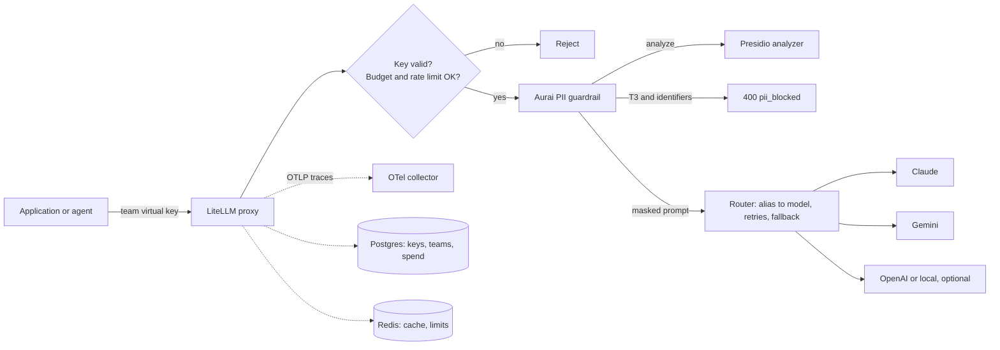

# aurai-gateway

The single front door for model access on **Aurai**, the enterprise AI platform for Amazing-Enterprise (a fictional company; all data is synthetic). Every application, agent and workflow calls models through this gateway, so access, cost, safety and tracing are handled in one place.

Product context and decisions are in [`aurai-docs`](https://github.com/ravalanup/aurai-docs) (see ADR 0002: single AI gateway). The cluster it runs on comes from [`aurai-infra`](https://github.com/ravalanup/aurai-infra).

## What it does

| Capability | How |
|---|---|
| One OpenAI-compatible endpoint | [LiteLLM](https://github.com/BerriAI/litellm) proxy |
| Model aliases, not vendor names | `aurai-fast`, `aurai-balanced`, `aurai-reasoning`, plus Gemini, optional OpenAI and local Ollama |
| Fallbacks and retries | Per-alias fallback order, checked so a fallback never serves a tier it is not approved for |
| Approved model catalog | [`config/model-catalog.yaml`](config/model-catalog.yaml): provider, data handling, permitted risk tiers |
| PII masking by risk tier | Microsoft Presidio analyzer plus a LiteLLM guardrail ([`src/aurai_gateway`](src/aurai_gateway)) |
| Team keys, budgets and rate limits | Policy as code in [`teams/teams.yaml`](teams/teams.yaml), applied with `aurai-teamctl` |
| Tracing and cost | OpenTelemetry to the shared collector; spend tracked per team in LiteLLM |
| Kubernetes deployment | Helm chart in [`charts/aurai-gateway`](charts/aurai-gateway) |

## How a request flows



## Risk tiers at the gateway

A team's risk tier lives in its metadata, set by the platform team. Callers cannot choose or lower it.

| Tier | Masked | Blocked | Trace flag | If the analyzer is down |
|---|---|---|---|---|
| T0 | government and financial identifiers | none | no | allow |
| T1 | identifiers, email, phone, IP address | none | no | allow |
| T2 | identifiers, contact details, names, places | none | yes | block |
| T3 | contact details, names, places | identifiers (cards, SSN, passports and similar) | yes | block |

Details: [docs/guardrails-and-risk-tiers.md](docs/guardrails-and-risk-tiers.md).

## Quick start (local)

Prerequisites: the local cluster from `aurai-infra` is running, plus Docker, kind, kubectl, Helm, Python 3.11+, and at least one provider key.

```powershell
# 1. Platform (from the aurai-infra repo)
.\local\scripts\up.ps1

# 2. Gateway (from this repo)
$env:ANTHROPIC_API_KEY = "<your key>"      # and optionally GEMINI_API_KEY
.\scripts\deploy-local.ps1
.\scripts\port-forward.ps1                 # leave running; http://localhost:4000

# 3. Teams and a key (new terminal)
python -m venv .venv; .\.venv\Scripts\Activate.ps1; pip install -e ".[dev]"
$env:LITELLM_MASTER_KEY = kubectl get secret litellm-secrets -n aurai-gateway -o jsonpath='{.data.master-key}' | % { [Text.Encoding]::UTF8.GetString([Convert]::FromBase64String($_)) }
aurai-teamctl apply teams/teams.yaml
python examples/demo.py                    # same prompt through T0, T1, T2 and T3 teams
```

macOS, Linux or WSL: use `scripts/deploy-local.sh`.

## Develop

```bash
pip install -e ".[dev]"
pytest              # policy, PII handling, catalog and team rules, chart-to-catalog consistency
ruff check .
aurai-teamctl validate teams/teams.yaml
```

Tests use a fake analyzer, so they run offline. CI also lints and renders the Helm chart and scans the image.

## Repository layout

```text
.
├── charts/aurai-gateway/       # Helm chart: LiteLLM, Presidio, config, network policy, External Secrets
├── config/
│   ├── model-catalog.yaml      # approved models, permitted tiers, fallbacks
│   └── custom_guardrail.py     # entry point LiteLLM loads
├── src/aurai_gateway/          # PII policy, analyzer client, guardrail, team tooling
├── teams/teams.yaml            # teams, budgets, limits, allowed models (as code)
├── tests/
├── examples/                   # tier demo and minimal calls
├── scripts/                    # local build, deploy, port-forward
├── docs/
└── Dockerfile                  # LiteLLM base image plus the aurai_gateway package
```

## Documentation

- [Architecture](docs/architecture.md)
- [Model routing and catalog](docs/model-routing.md)
- [Guardrails and risk tiers](docs/guardrails-and-risk-tiers.md)
- [Team onboarding](docs/team-onboarding.md)
- [Runbook](docs/runbook.md)

## Status

Prototype-scale gateway using production patterns. What a larger rollout adds is listed in [docs/architecture.md](docs/architecture.md#what-production-would-add).

## License

MIT. See [LICENSE](LICENSE).
